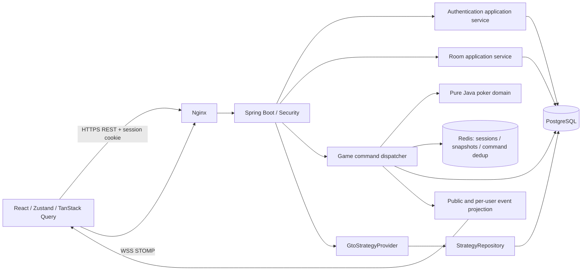

> 보관된 초기 설계입니다. GTO/전략 분석 계획은 폐기했으며 현행 바운티 규칙은 [bounty-mode.md](bounty-mode.md)를 따릅니다.

# 실시간 홀덤 MVP 설계

상태: 2026-10-29 목표 설계. 현재 친구용 게임 구현과 저장·전송 방식의 차이는 friends-mvp.md와 README를 참조한다. 이 문서의 DB outbox·영속 이력·GTO·이벤트 설계가 전부 구현되었다는 뜻은 아니다.

## 시스템 경계

`apps/web`는 표시와 사용자 입력만 담당한다. Query는 서버 리소스, Zustand는 단위·패널·연결 상태를 관리한다. STOMP 수신 결과를 서버 version 기준으로 적용한다. 브라우저는 카드·잔고·승패·사용자 ID를 확정할 수 없다.

`apps/api/com/holdem` 하위 `auth`, `room`, `game/domain`, `game/application`, `game/transport`, `strategy`, `history`로 분리한다. 엔진에는 Spring·JPA·WebSocket 의존성을 넣지 않는다. DTO와 엔티티를 분리하고 API 입력을 Bean Validation과 도메인 불변식으로 이중 검증한다.

MVP는 단일 게임 작성자 프로세스다. 방별 mailbox/lock 아래에서 명령 검증→상태 전이→결과 영속화를 직렬 실행한다. API 다중 인스턴스 운영은 지원하지 않는 상태로 시작한다. 확장 시 방 소유권, lease 및 fencing token과 외부 STOMP broker relay가 선행돼야 한다. Redis pub/sub만으로 명령 순서를 보장한다고 가정하지 않는다.

## 일관성 및 장애 복구

- 명령에는 `commandId`(UUID), `handId`, `expectedVersion`을 포함한다. 사용자 ID는 세션 Principal에서 얻는다.
- 방 lock 내부에서 권한·핸드·턴·버전·금액을 검증한다. 같은 사용자/commandId는 최초 결과를 반환하고 다른 payload 재사용은 거부한다. DB unique key로 재시작 뒤에도 중복 반영을 차단한다.
- PostgreSQL의 핸드 액션 로그·스냅샷·outbox를 한 트랜잭션으로 저장한다. commit 이전에는 이벤트를 전송하지 않는다. Redis는 캐시이며 DB에서 복원한다. outbox는 재전송될 수 있으므로 클라이언트는 eventId/version으로 중복 제거한다.
- 브라우저 reconnect 시 REST snapshot을 다시 읽고 version 이후 이벤트를 구독한다. version gap이 발생하면 즉시 snapshot을 재조회한다. 전송 성공을 액션 확정으로 취급하지 않는다.
- 액션 타이머는 서버 UTC deadline과 hand/version을 참조한다. 만료 작업도 같은 mailbox로 보내며 stale timer는 폐기한다. 체크 가능하면 CHECK, 아니면 FOLD 한다.
- 연결 끊김 후 60초 재접속 유예. 핸드 중에는 자동 체크/폴드하며 자리를 유지한다. 유예 종료 후 다음 핸드부터 제외한다. 명시적 퇴장은 현재 핸드 fold 후 잔여 칩을 기록하고 다음 안전한 경계에서 자리 제거한다.

## 인증 정책

게스트 POST는 서버 생성 UUID·임시 닉네임을 DB에 저장하고 SecurityContext를 세션에 저장한다. local 프로필 대체 로그인도 서버 발급 계정만 사용하며 운영에서는 등록하지 않는다. 로그인 시 session ID를 변경하고 CSRF 토큰을 갱신한다. 로그아웃은 CSRF 보호 POST, 세션 invalidate, 쿠키 삭제로 처리한다. Redis TTL 30분 유휴 만료; WebSocket 수신 시에도 현재 세션 유효성을 확인한다. 세션 만료 연결은 종료한다.

Google OIDC는 issuer/subject, Kakao OAuth는 provider/user id로 식별한다. `UNIQUE(provider, provider_subject)`를 강제한다. 이메일이 같다는 이유로 자동 병합하지 않는다. OAuth state·redirect URI 검증은 Spring Security를 사용한다. 현재 게스트 세션에서 시작한 인증에만 게스트 승격을 허용한다. 이미 다른 계정에 연결된 OAuth ID이면 자동으로 칩·기록을 합치지 않고 기존 계정으로 로그인하며 충돌을 알린다. 계정 연결은 양쪽 계정 재인증이 필요한 별도 흐름으로 둔다.

운영은 동일 origin HTTPS, HttpOnly/Secure/SameSite=Lax 쿠키, 신뢰 origin allowlist, POST/PATCH/DELETE CSRF 검증을 사용한다. STOMP CONNECT도 세션과 CSRF를 검사한다. 방 멤버십 없이 구독하거나 `/user` 경로에 임의 사용자 ID를 지정할 수 없게 한다. 클라이언트 SEND는 `/app`만, 서버 topic/user destination 직접 SEND는 차단한다. 개인 카드와 덱은 로그·공개 snapshot·공개 broker 메시지에서 제외한다.

## 게임 엔진 규칙

52장 덱은 SecureRandom 기반 Fisher–Yates로 섞는다. 7장 중 최상위 5장의 category와 kicker tuple을 비교한다. A2345 wheel은 5-high. Royal Flush는 ace-high Straight Flush 표시다. 카드 rank/suit와 덱 유일성을 불변식으로 검사한다.

상태는 WAITING→PREFLOP→FLOP→TURN→RIVER→SHOWDOWN→SETTLED. 각 스트리트는 참여 가능한 전원이 currentBet에 도달하고 응답해야 할 액션이 없어야 닫힌다. all-in으로 더 이상 베팅할 수 없으면 보드를 서버에서 runout한다. 한 명만 남으면 홀 카드 공개 없이 정산한다.

금액은 long 정수, 요청 `amountTo`는 해당 스트리트 최종 누적 베팅액이다. Call은 `min(currentBet-ownBet, stack)`. 최소 opening bet은 BB, 최소 raise-to는 currentBet+lastFullRaise. 부족한 all-in raise는 허용하지만 이전 행동자의 raise 권한을 다시 열지 않는다. 여러 short all-in의 누적 증가가 full raise 크기에 도달하면 해당 플레이어의 마지막 행동 기준으로 권한을 재평가한다. 액션 가능 집합을 엔진이 계산해 UI와 GTO에 전달한다.

팟은 플레이어별 총 기여액을 오름차순 경계로 나눠 계산한다. Fold 플레이어의 칩은 포함하되 승자 후보에서는 제외한다. 일방 기여분은 uncalled bet으로 반환한다. 각 side pot은 별도 승자 판정하며 동률은 나눈다. 정수 나눗셈 잔여 칩은 BTN 다음부터 시계 방향 승자에게 한 칩씩 지급한다. 레이크는 MVP 0이다. `sum(stack)+sum(committed)=initialTableChips`를 매 액션·정산마다 검사하고 정산은 hand ID 기준 한 번만 수행한다.

좌석 순서는 물리 좌석 번호를 원형으로 순회한다. 6명 BTN/SB/BB/UTG/HJ/CO, 5명 BTN/SB/BB/UTG/CO, 4명 BTN/SB/BB/CO, 3명 BTN/SB/BB. Heads-up은 BTN=SB이고 preflop SB가 먼저, postflop BB가 먼저다. 3명 이상 preflop은 BB 다음, postflop은 BTN 다음의 살아 있는 플레이어가 먼저다. 핸드 종료 후 다음 유효 좌석으로 BTN 회전. 도중 참가자는 다음 핸드부터 배분한다. 잔고 0은 다음 핸드 제외한다.

## 방과 무료 칩

바이인은 절대 범위 1..1,000,000 및 방 범위를 모두 만족해야 한다. join 시 스택을 한 번 지급하고 재접속에는 지급하지 않는다. 현금 결제·충전·환전·송금은 없다. BB/원 모드는 정수 칩의 클라이언트 표시만 변경한다. BB 표시 반올림은 서버 연산에 사용하지 않는다.

방 코드는 혼동 문자를 제외한 8자리 SecureRandom 문자열, DB unique 위반 시 제한 횟수 재생성한다. 비밀번호는 BCrypt로 저장하고 응답에 포함하지 않는다. join/password/code 시도는 사용자·IP별 제한한다. 초대 URL은 origin + `/join/{code}`, 비밀번호를 URL에 포함하지 않는다. PUBLIC/PRIVATE 목록 접근을 구분한다.

방장만 설정·시작·대기자 관리를 실행한다. SB>0, BB>=2*SB, buyin 범위를 검증한다. 진행 중 블라인드 수정은 pending 설정으로 보관하고 다음 핸드 시작에 원자적으로 적용한다. 호스트 퇴장 시 가장 오래 참여한 활성 멤버에게 위임한다. 시작은 2명 이상, 착석자 전원 ready, 유효 스택으로 검증한다. 정산 후 5초 뒤 다음 핸드를 시작한다.

## GTO 계약

`GtoStrategyProvider.find(StrategyContext): StrategyResult`, `PreflopStrategyProvider`, `PostflopStrategyProvider`, `StrategyRepository`로 분리한다. StrategyContext는 variant, positions, hole hand class, street, effectiveStackBB, blinds, action history, current bet, pot, opponents, player count, board, bet sizes, rake, allowedActions를 포함한다. 정규화된 exact scenario key로 조회하고 근사값을 GTO인 것처럼 제시하지 않는다.

ActionFrequency는 action/amountTo/frequency(decimal 0..1). 데이터 import 시 출처 URL, 라이선스, solver 버전, 계산 조건, 검증일, 허용 bet size를 필수로 저장한다. 합계 오차는 0.0001 이하. 불가능한 액션이 포함되면 나머지를 재정규화하지 않고 조건 불일치로 거부한다. 빈 결과는 `NO_DATA`와 사유를 반환한다. 다른 조건 데이터를 대신 출력하지 않는다.

13×13 행렬은 AA..22 대각선, 위 suited, 아래 offsuit. 현재 패를 강조하되 데이터 없는 셀은 빈 상태다. stack 조회는 지원된 exact bucket만 허용한다. Postflop은 provider 연동 전 전부 NO_DATA. 룸 studyAllowed=false이면 진행 중 전략 API를 서버에서 거부한다. Normal은 숨김, Study는 본인 패에만 조회, Review는 정산된 핸드 중 본인에게 공개된 정보만 사용한다.

## 저장 구분

PostgreSQL: 사용자, OAuth 연결, 방 설정/멤버십, 핸드/액션/정산, command dedup/outbox, 전략/출처. Redis: 세션, presence, deadline 인덱스, 공개/개인 snapshot 캐시. Redis 장애 시 신규 명령 수락을 중단하고 DB 기반 복구 후 재개한다. 핸드 덱 및 비공개 스냅샷은 서버 전용 저장과 접근 제어를 적용한다. API는 JPA 엔티티를 직렬화하지 않는다.
