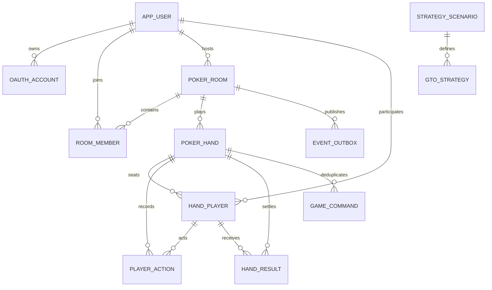

> 보관된 초기 설계입니다. GTO/전략 분석 계획은 폐기했으며 현행 바운티 규칙은 [bounty-mode.md](bounty-mode.md)를 따릅니다.

# 관계형 모델 (목표 ERD)

현재 Flyway V1은 app_user/oauth_account만 생성한다. 아래 나머지 모델은 해당 Phase에서 후속 migration으로 추가한다.

| Table | Key columns and constraints |
|---|---|
| app_user | UUID PK, nickname, guest, created_at; personal identity never trusted from browser |
| oauth_account | UUID PK, user_id FK, provider, provider_subject; unique(provider,provider_subject) |
| poker_room | UUID PK, host_user_id FK, code unique, visibility, password_hash nullable, capacity 2..6, sb/bb, pending_blinds JSONB, min/max_buyin 1..1M, study_allowed, state, version |
| room_member | UUID PK, room_id/user_id FKs, seat nullable 0..5, stack bigint >=0, ready, joined_at, state; unique(room_id,user_id), unique(room_id,seat); active seat cannot belong to two users |
| poker_hand | UUID PK, room_id FK, hand_number, button_seat, sb/bb snapshot, street, board JSONB, version, state_snapshot JSONB server-only, started_at, settled_at; unique(room_id,hand_number) |
| hand_player | UUID PK, hand_id/user_id FKs, seat, position, starting_stack, hole_cards server-only, folded; unique(hand_id,seat) |
| player_action | UUID PK, hand_id/hand_player_id FKs, sequence, street, action, amount_to, chips_delta, occurred_at; unique(hand_id,sequence) |
| hand_result | UUID PK, hand_id/hand_player_id FKs, pot_index, payout>=0, ranking nullable, revealed_cards nullable; unique(hand_id,hand_player_id,pot_index) |
| strategy_scenario | UUID PK, context_hash unique, normalized_context JSONB, source_url, license, solver_version, conditions JSONB, verified_at |
| gto_strategy | UUID PK, scenario_id FK, hand_class, action, amount_to nullable, frequency numeric(9,8) 0..1; unique(scenario_id,hand_class,action,amount_to); importer verifies sum |
| game_command | UUID PK, room_id, hand_id nullable FK, user_id FK, command_id, payload_hash, result JSONB; unique(user_id,command_id) |
| event_outbox | UUID event_id PK, room_id FK, version, event_type, public_payload JSONB, private_payload server-only, published_at; index(published_at,created_at) |

방 상태는 optimistic version과 application room lock으로 갱신한다. 금액은 bigint, 날짜는 TIMESTAMPTZ/UTC다. 기록에는 (hand_id,sequence), 공개방 목록에는 (visibility,state,bb) 인덱스를 둔다. 사용자 삭제는 핸드 기록을 cascade delete하지 않고 개인정보를 익명화한다.
